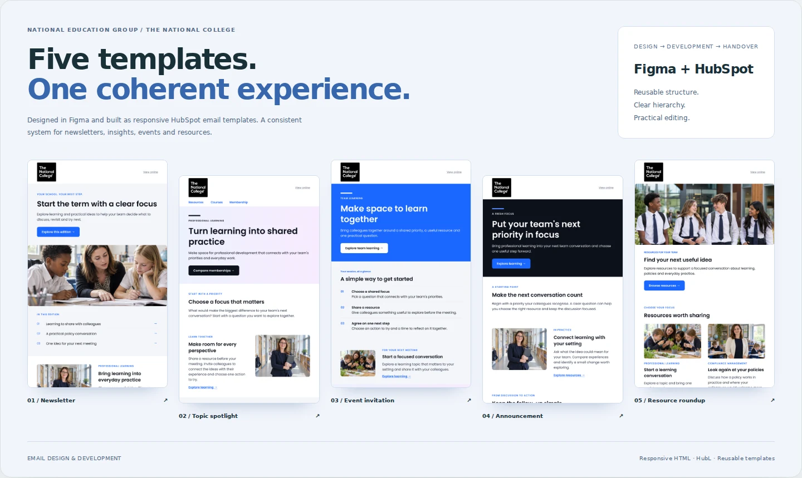

# HubSpot email design and development

**[Live design gallery](https://cyavash.github.io/hubspot-crm-portfolio/email.html) · [Responsive HubL email reference](hubspot-email-reference.html)**

The gallery contains five actual design exports. The coded email reference is a separate reusable development sample using responsive presentation tables, company settings and unsubscribe variables. HubSpot compilation and real email-client checks are required before campaign use.
