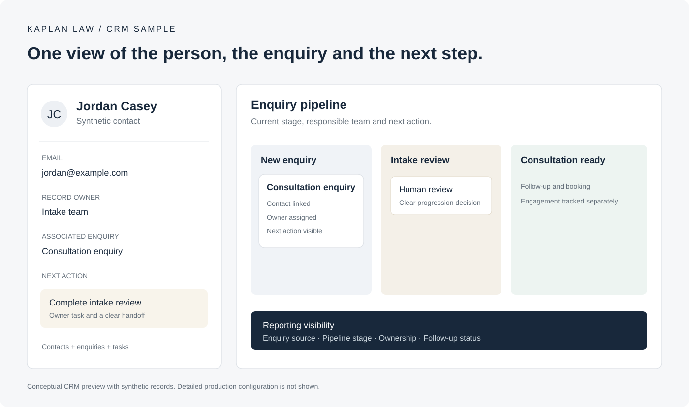

# HubSpot CRM & Automation

CRM architecture, workflow automation and customer-service systems by **Siavash Zahir**, HubSpot Solutions Architect & Developer.

## Kaplan Law | Intake and follow-up

A concise view of a legal-services intake process: enquiries enter HubSpot, receive an intake review, move through a clear pipeline and reach the responsible team for follow-up.

The preview uses fictional contact details. Client routing rules, field mappings and production records remain private.

## What the work covers

- Contact, company and deal relationships that support the team's actual process.
- Clear lifecycle stages, pipeline ownership and follow-up responsibility.
- Connected forms, lead sources, meeting booking and operational handoffs.
- Duplicate prevention, data quality, workflow review and reliable reporting.
- Service Hub, Breeze Customer Agent, knowledge sources and human escalation.
- HubSpot integrations with n8n, Zapier, Make and external APIs.

## Selected results

| Project | Outcome |
| --- | --- |
| Enveseur | Support across 3 brands, 2 languages and 10 country branches. Median first human response reduced from 4 hours to 55 minutes. |
| DataBiologics | 18,000 records standardized; source and ownership completeness improved from 72% to 97%. |
| RMDY Academy | Six intake forms connected through Zapier. Duplicate creation reduced from 5% to 0.5%. |

[Development samples](https://github.com/cyavash/cyavash/tree/main/showcase) · [Portfolio](https://siavash.tech/) · [Hire me on Upwork](https://www.upwork.com/freelancers/siavash/)
