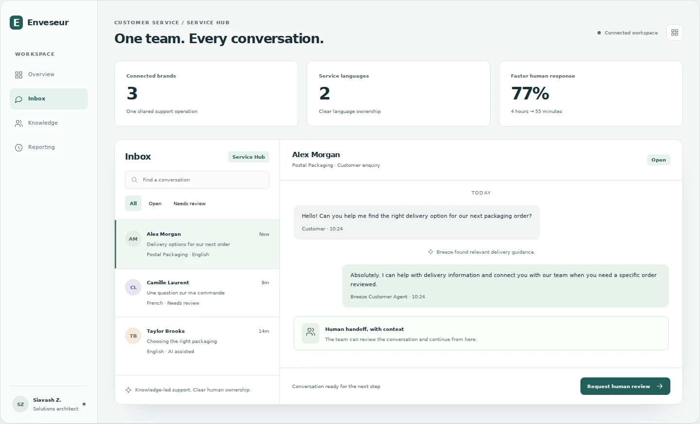
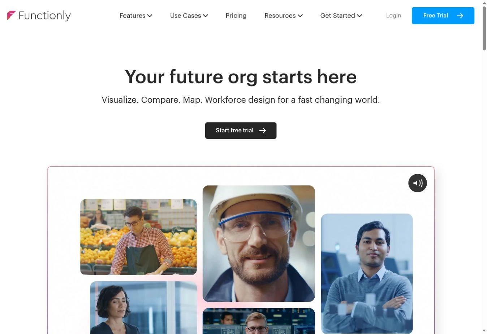
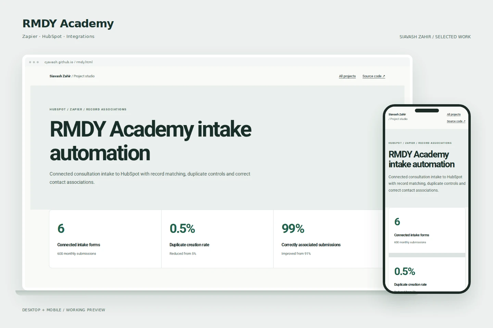
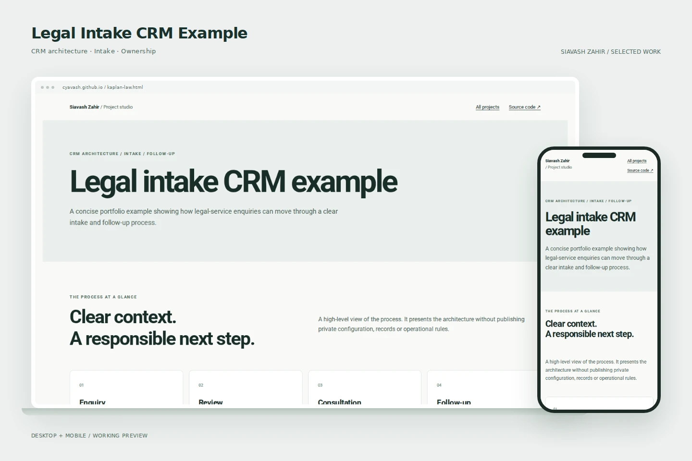
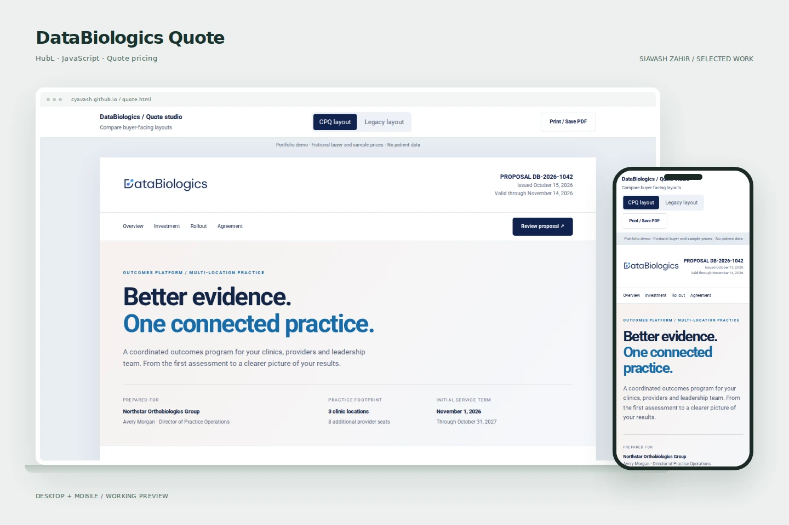
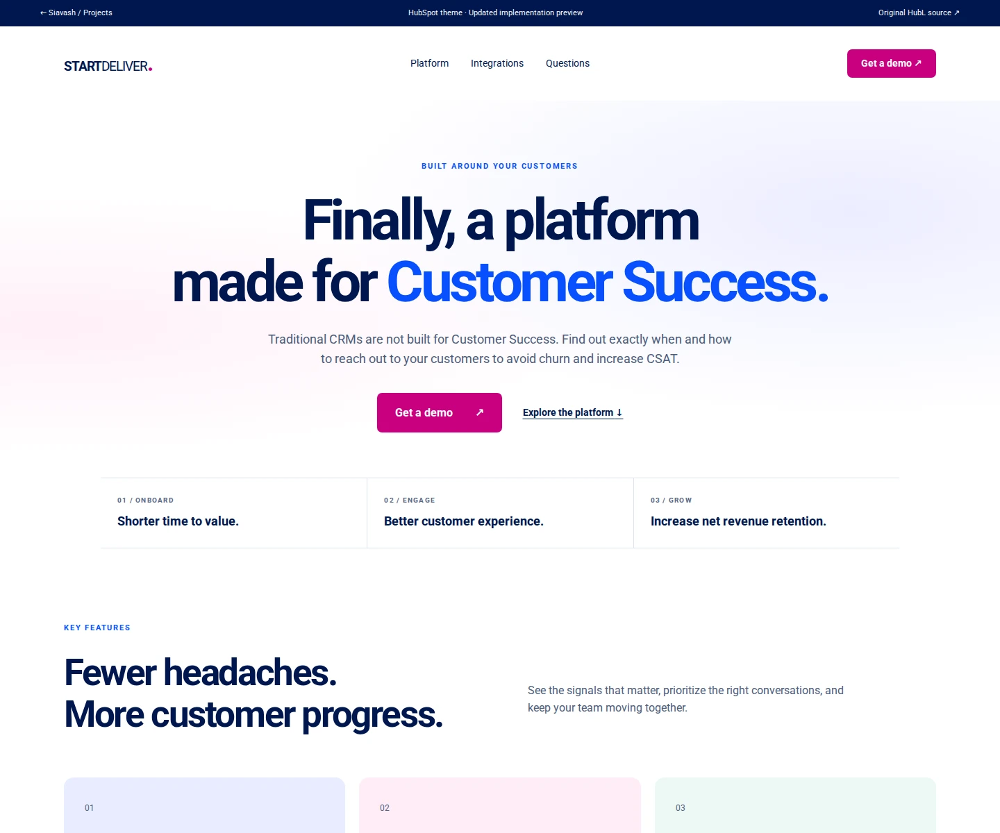

# HubSpot, CRM & Web Development

**Siavash Zahir — HubSpot Solutions Architect & Developer**

CRM architecture, HubL development, WordPress, integrations and email systems. 13+ years across web development, CRM and business systems.

[Explore the live project studio](https://cyavash.github.io/hubspot-crm-portfolio/) · [Portfolio](https://siavash.tech/) · [GitHub Projects](https://github.com/users/cyavash/projects/1)

## Enveseur

Service Hub architecture, multilingual support, knowledge sources and human escalation.

[Interactive preview](https://cyavash.github.io/hubspot-crm-portfolio/enveseur.html) · [Case and role](enveseur.md) · [Code](enveseur.html)

## Functionly

Figma design, HubL development, reusable modules and connected lead capture.

[Interactive preview](https://cyavash.github.io/hubspot-crm-portfolio/functionly.html) · [Case and role](functionly.md) · [Code](functionly.html)

## DataBiologics

WordPress design and development connected to HubSpot CRM, lifecycle tracking and reporting.

[Interactive preview](https://cyavash.github.io/hubspot-crm-portfolio/databiologics.html) · [Case and role](databiologics.md) · [Code](databiologics.html)

## Building Brokers WA

A four-step qualification journey with HubSpot, automated follow-up and meeting booking.

[Interactive preview](https://cyavash.github.io/hubspot-crm-portfolio/bbwa.html) · [Case and role](bbwa.md) · [Code](bbwa.html)

## RMDY Academy

Zapier and HubSpot intake matching, create/update controls and submission associations.

[Interactive preview](https://cyavash.github.io/hubspot-crm-portfolio/rmdy.html) · [Case and role](rmdy.md) · [Code](rmdy.html)

## Kaplan Law

A concise legal-services CRM workspace and intake handoff preview.

[Interactive preview](https://cyavash.github.io/hubspot-crm-portfolio/kaplan-law.html) · [Case and role](kaplan-law.md) · [Code](kaplan-law.html)

## DataBiologics Quote

A branded quote reference with billing choices, optional services and print layouts.

[Interactive preview](https://cyavash.github.io/hubspot-crm-portfolio/quote.html) · [Case and role](quote.md) · [Code](quote.html)

## The National College

Figma design and responsive HubSpot email development across five reusable formats.

[Interactive preview](https://cyavash.github.io/hubspot-crm-portfolio/email.html) · [Case and role](email.md) · [Code](email.html)

## StartDeliver

HubSpot CMS implementation with reusable modules, native navigation, accessible interactions and maintainable source.

[Interactive preview](https://cyavash.github.io/hubspot-crm-portfolio/startdeliver.html) · [Case and role](startdeliver.md) · [Code](startdeliver.html)

## Skopenow

HubSpot layouts and custom modules with native JavaScript, semantic structure and practical content editing.

[Interactive preview](https://cyavash.github.io/hubspot-crm-portfolio/skopenow.html) · [Case and role](skopenow.md) · [Code](skopenow.html)

## Engineering

- [Native UI reference](native-ui/): scoped disclosures, keyboard tabs, search, filtering, menus and user-controlled carousels without jQuery.
- [WordPress reference](WORDPRESS.md): scoped styling, escaped output and reusable content.
- [HubSpot email reference](hubspot-email-reference.html): responsive tables, HubL settings and unsubscribe links.
- [Validation and limits](ENGINEERING.md).

Public previews are reference builds, separate from client production websites. Original repository histories remain intact.
