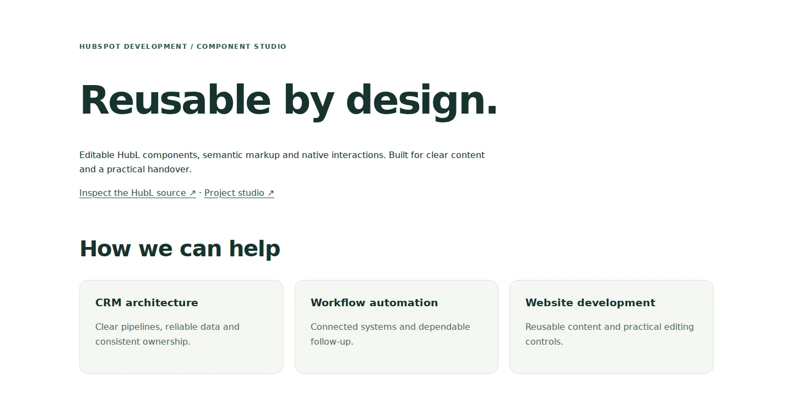

# HubSpot Component Studio

Independently authored, reusable HubL components and native JavaScript. The package contains no client page exports, account identifiers, tracking code, credentials or production form connections.

[Live component preview](https://cyavash.github.io/hubspot-crm-portfolio/components/preview.html) · [Project studio](https://cyavash.github.io/hubspot-crm-portfolio/)

## Components

| Module | Editing controls | Behavior |
| --- | --- | --- |
| [Service summary](modules/service-summary.module/) | Heading, repeater items, optional links | Escaped text and URLs, email links, new-tab and nofollow controls |
| [FAQ](modules/faq.module/) | Heading, question and answer repeater | Native details/summary; works without JavaScript |
| [Content tabs](modules/content-tabs.module/) | Heading and content repeater | Arrow/Home/End navigation, roving focus, independent instances and readable fallback |

The page template includes a skip link, one primary heading, escaped metadata, scoped styling and HubSpot's required header/footer includes. System fonts and local assets avoid external runtime dependencies. The WordPress and email references remain available in the repository root.

## Use in HubSpot

Upload the `hubspot` folder as a theme in your own sandbox using your normal HubSpot development workflow. Create a page with the Component landing page template and edit the three module instances. Configure real links through the module fields. No form, CRM, payment or email operation is performed by the package.

## Verify

From the repository root, run `npm ci --ignore-scripts`, `npm run check` and `npm test`. Tests cover keyboard selection, focus, instance isolation, nested scopes, ID collisions, progressive fallback and repeat initialization.

The static preview and local checks do not establish HubSpot compilation or full accessibility conformance. Validate editor rendering, real content and target browsers in a sandbox before production use. The template conventions follow the official [HubSpot CMS theme boilerplate](https://github.com/HubSpot/cms-theme-boilerplate).
