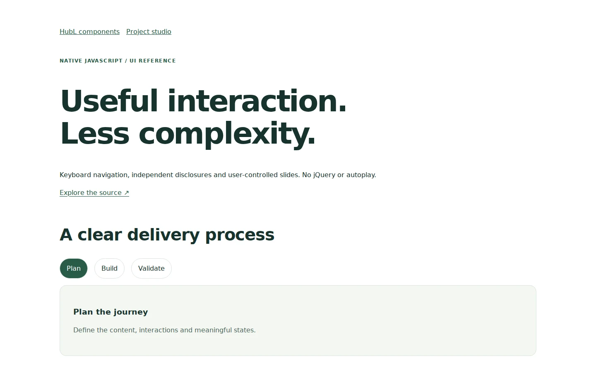

# Native UI reference

**[Live preview](https://cyavash.github.io/hubspot-crm-portfolio/components/native-ui.html) · [JavaScript](native-ui.js) · [CSS](native-ui.css)**

Dependency-free interactions for content-driven websites: scoped FAQ disclosures, keyboard tabs, combined search/category filters, accessible navigation, user-controlled carousels and video dialogs. No autoplay, client tracking configuration or production form endpoints.

Run `npm ci` and `npm test` from the repository root. Adopt the selectors for your template markup, then validate in your target CMS.
