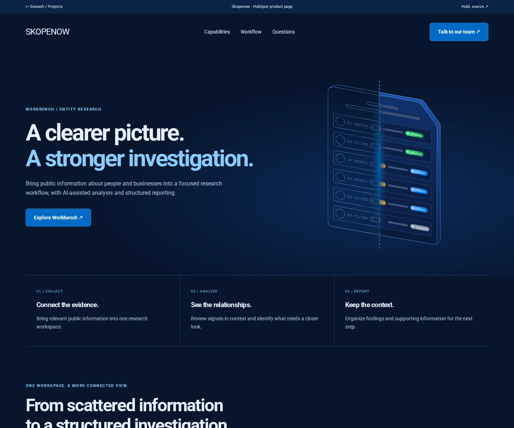

# Skopenow focused templates

[Live preview](https://cyavash.github.io/hubspot-crm-portfolio/skopenow.html)

Newly authored focused HubL templates based on the original client website's information architecture and identity, using existing brand artwork. These files are a separate, focused package rather than a complete original theme export.

## Scope and validation

The product page includes an editable hero, original brand graphics, an accessible capability tab group, process sections, native FAQ disclosures and reduced-motion-aware scroll reveals. Tab content is readable without JavaScript; arrow keys, Home and End move between enhanced tabs. CTA links open the client's public product inquiry routes and do not submit data.

Upload the whole directory as a theme to a HubSpot test portal, configure page metadata and navigation routes, and preview the relevant template. Static desktop/mobile accessibility and interaction checks do not constitute HubL compilation or portal editor validation. Those portal checks remain outstanding.
