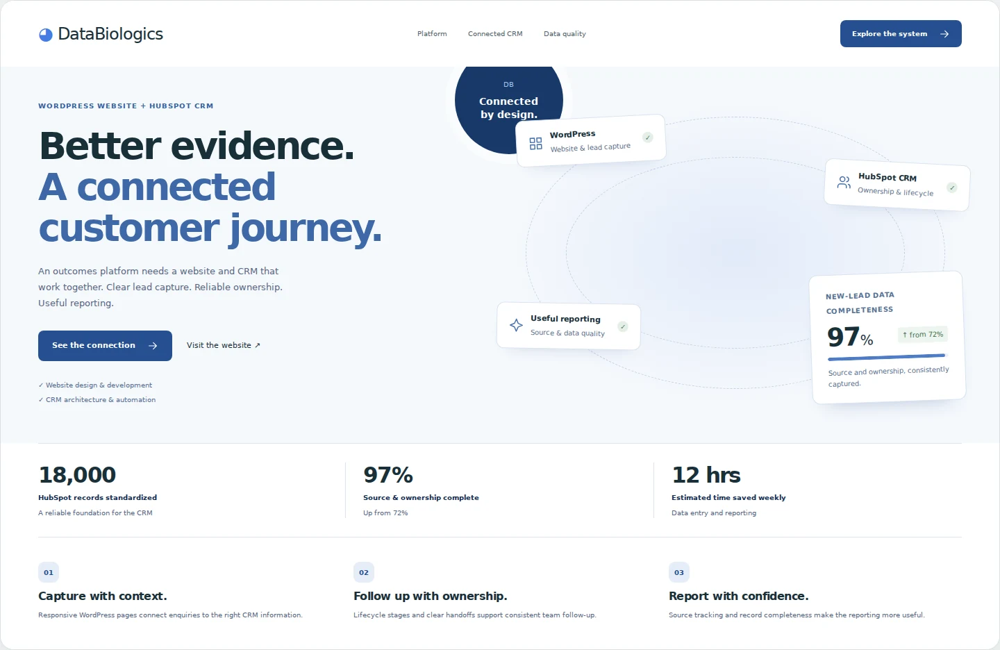

# DataBiologics homepage

[Live homepage preview](https://cyavash.github.io/hubspot-crm-portfolio/databiologics.html)

Focused WordPress homepage theme, newly authored around the existing blue identity and patient-outcomes positioning. Includes standard header/footer hooks, title support, menu registration, local font assets, reusable template parts, escaped Customizer heading/description and a fallback content template. No jQuery, tracking or client form configuration is bundled.

The public preview is static HTML representing the homepage. Install the directory as a theme in a WordPress staging site, set the site identity, configure navigation and enquiry URLs, and review the Homepage Customizer settings. The source intentionally does not connect a production CRM or add clinical data handling.

Static responsive and accessibility checks are verified. PHP runtime, WordPress activation, theme editor and CRM integration checks have not been run in this environment. Configure page-specific SEO metadata using the site's SEO plugin and verify it on staging before production deployment.
